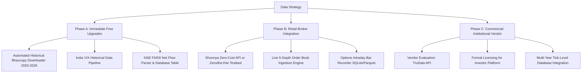

# DATA REQUIREMENTS AND SOURCES SPECIFICATION
**Indian Options AI Platform — Phase 17 Quantitative & Architectural Audit**
*Date: September 2026 | Environment: Indian Equity & Derivatives (NSE / BSE)*

---

## 1. Executive Summary & Governance Notice

> [!IMPORTANT]
> **GOVERNANCE DIRECTIVE — ZERO UNAUTHORIZED EXPENDITURE**
> - `PURCHASE_AUTHORIZED=FALSE`: No commercial vendor contracts or automated data purchases are authorized.
> - `AUTOMATED_VENDOR_CONTACT=DISABLED`: No automated scraping or unauthorized API connections.
> - `SCIENTIFIC INTEGRITY`: Synthetic or interpolated data must NEVER be passed off as authentic market observations. All data limitations must be surfaced explicitly to researchers and investors.

The Indian Options AI platform requires multi-layered market data across underlying equity indices (NIFTY 50, BANK NIFTY, FINNIFTY, NIFTY MIDCAP 50), liquid single-stock equities, and exchange-traded derivative instruments (Index Options, Stock Options, Index Futures). This document provides an exhaustive inventory of required data elements, evaluated sources, licensing terms, and integration architectures.

---

## 2. Exhaustive Data Requirements Inventory

| Layer | Data Element | Frequency / Horizon | Minimum History Required | Current Platform Status | Primary Use Case |
|---|---|---|---|---|---|
| **L1: Cash Market EOD** | Daily OHLCV, VWAP, Delivery Qty, Delivery % | 1 Day | 10+ Years (2014–Present) | **AVAILABLE** (NSE Bhavcopy / yfinance) | Long-term regime classification, macro momentum, baseline returns |
| **L2: Cash Intraday** | 1-min & 5-min OHLCV bars | 1-min / 5-min | 2–5 Years | **PARTIAL** (yfinance 60d limit; Kite/Upstox API live) | Intraday momentum, opening range breakouts (ORB), realized volatility |
| **L3: Derivatives EOD** | Futures & Options Bhavcopy (Strike, Expiry, Option Type, Close, Settle, OI, Chg in OI, Volume) | 1 Day | 5+ Years (2019–Present) | **AVAILABLE** (NSE FO Bhavcopy / PR zip archives) | Historical Max Pain, PCR, OI concentration, EOD IV curves |
| **L4: Derivatives Intraday** | 1-min / 5-min Options OHLCV + OI per strike | 1-min / 5-min | 2+ Years | **UNAVAILABLE / BLOCKED** (Requires paid tick/minute vendor) | Intraday delta-neutral rebalancing, gamma scalping, real-time OI shifts |
| **L5: Real-Time Order Book** | 5-depth / 20-depth Bid-Ask quotes, tick-by-tick (TBT) | Tick / Millisecond | Live stream | **BLOCKED** (Requires active broker WebSocket token) | Market microstructure, realistic execution simulation, slippage modelling |
| **L6: Volatility Indices** | India VIX Daily & Intraday OHLCV | Daily / 5-min | 10+ Years | **PARTIAL** (Daily via yfinance `^INDIAVIX`; Intraday via Kite) | Volatility regime switching, fear gauge, option pricing calibrator |
| **L7: Institutional Flows** | FII / DII Gross Purchases, Gross Sales, Net Inflow (Cash & F&O) | Daily EOD | 5+ Years | **PARTIAL** (NSE scraper stub; needs normalized DB storage) | Smart money positioning, institutional liquidity bias |
| **L8: Corporate Actions** | Dividends, Stock Splits, Bonus, Rights, De-mergers | Event-driven | 10+ Years | **PARTIAL** (yfinance / NSE corporate announcements) | Ex-dividend Black-Scholes cost-of-carry adjustments, strike adjustments |
| **L9: Macroeconomic Factors** | RBI Repo Rate, TREPS / MIBOR, CPI, GDP, USDINR FX Rate | Daily / Monthly | 10+ Years | **PARTIAL** (Fixed risk-free rate proxy $r=6.5\%$; needs live RBI DB) | Risk-free rate in Black-Scholes ($r$), currency risk |

---

## 3. Legitimate & Compliant Data Sources

### 3.1 Tier 1: Free Public Official Data (Legitimate, Zero Cost)
1. **NSE India Public Archives (`archives.nseindia.com`)**:
   - *Data*: Daily Equity Bhavcopy (`cm<date>bhav.csv.zip`), Derivatives Bhavcopy (`fo<date>bhav.csv.zip`), New Unified Bhavcopy format (`BhavCopy_NSE_CM_0_0_0_<date>_F_0000.csv.zip`).
   - *Coverage*: 2000–Present.
   - *Format*: CSV / ZIP.
   - *License/Usage*: Public regulatory dissemination. Free for academic and personal research; commercial redistribution restricted.
   - *Reliability*: High (official source of truth). Requires robust scraper handling for rotating user-agents and TLS fingerprints.

2. **BSE India Public Archives (`bseindia.com`)**:
   - *Data*: BSE Equity & Derivatives Bhavcopy, SME segment.
   - *Coverage*: 1995–Present.
   - *Usage*: Cross-market price verification and redundancy.

3. **Reserve Bank of India Database on Indian Economy (DBIE - `dbie.rbi.org.in`)**:
   - *Data*: Historical MIBOR, Call Money Rates, Treasury Bill yields (91-day, 182-day, 364-day), Macroeconomic series.
   - *Usage*: Dynamic term structure of interest rates ($r(t)$) for option pricing.

### 3.2 Tier 2: Free / Freemium Developer APIs (Non-Commercial / Research)
1. **Yahoo Finance (`yfinance`)**:
   - *Data*: Index and Cash Equity daily OHLCV (up to max history), intraday 1-min (last 7 days), intraday 5-min / 15-min (last 60 days).
   - *Pros*: Completely free, effortless integration via Python wrapper.
   - *Limitations*: No options chain history; delayed by 15 minutes during live sessions; frequent rate limits and schema changes; unofficial API.

2. **Google Finance / Alpha Vantage / Tiingo**:
   - *Limitations*: Poor or non-existent Indian derivatives coverage; delayed Indian equity data.

### 3.3 Tier 3: Indian Retail Broker APIs (Low Cost, High Intraday Quality)
1. **Zerodha Kite Connect API**:
   - *Cost*: ₹2,000/month (Base API) + ₹2,000/month (Historical Data API).
   - *Capabilities*: Tick-by-tick live WebSocket (up to 3,000 instruments simultaneously), 1-min historical bars for Cash, Futures, and Active Options contracts back ~1-2 years. 5-depth order book in real-time.
   - *Requirements*: Active Zerodha trading account, daily automated TOTP/session token generation.
   - *Status*: Codebase has provider stub implemented in `src/ingestion/kite_provider.py`.

2. **Upstox Developer API (v2)**:
   - *Cost*: Free for basic API with active Demat account; nominal fees for historical data.
   - *Capabilities*: Market quotes, options chain LTP/OI via REST & WebSocket, intraday historical candles.
   - *Status*: Provider stub implemented in `src/ingestion/upstox_provider.py`.

3. **Shoonya (Finvasia)**:
   - *Cost*: ₹0 (Completely Free API and Historical Data).
   - *Capabilities*: Live tick WebSocket, historical intraday bars, options Greeks stream.
   - *Assessment*: Ideal zero-cost candidate for sandbox paper-trading and live data streaming without ongoing vendor fees.

4. **Angel One SmartAPI**:
   - *Cost*: Free for retail accounts; Historical API available.
   - *Capabilities*: WebSocket streaming, historical data for equities and F&O.

### 3.4 Tier 4: Authorized Commercial Data Vendors (Institutional Quality)
1. **TruData (`trudata.in`)**:
   - *Authorization*: NSE / MCX authorized real-time data vendor.
   - *Offerings*: REST API + WebSocket feeds. Complete historical tick and 1-minute data for Index and Stock Options dating back 5–10 years with Greeks and OI.
   - *Cost*: ~₹3,500 – ₹8,000/month depending on segments and concurrency.

2. **GlobalDataFeeds (GDF / Nimble Data)**:
   - *Authorization*: NSE / BSE authorized vendor.
   - *Offerings*: Real-time Level 2 (depth) feeds, historical tick databases.
   - *Target*: Enterprise backtesting requiring exact bid-ask order books.

---

## 4. Critical Data-Capability Matrix

| Capability Dimension | Current Free Setup (NSE Bhavcopy + yfinance) | Retail Broker Setup (Kite / Upstox / Shoonya) | Institutional Setup (TruData / GDF) |
|---|---|---|---|
| **EOD Cash & F&O Analysis** | **FULL** (Daily close, volume, OI) | FULL | FULL |
| **Historical Options Backtesting** | **LIMITED** (Daily close only; no intraday bid/ask) | **MODERATE** (1-min bar backtest; simulated spread) | **FULL** (Exact tick-level bid/ask order book) |
| **Real-Time Paper Trading (Equity)** | **FUNCTIONAL** (Delayed or EOD) | **REAL-TIME** (Live 5-depth bid-ask fills) | **REAL-TIME** (Full depth, low latency) |
| **Real-Time Paper Trading (Options)** | **DISABLED** (Synthetic fills rejected) | **FUNCTIONAL** (Live bid/ask execution) | **FULL** (Realistic fill simulation with queue priority) |
| **Intraday Volatility Surface / Greeks** | **ESTIMATED** (EOD close snapshot only) | **REAL-TIME** (Continuous live surface) | **INSTITUTIONAL** (Full tick surface + historical IV) |
| **Regulatory & Licensing Compliance** | Research / Academic only | Retail personal algorithmic trading | Commercial investor demonstration & institutional funds |

---

## 5. Immediate Data Acquisition Action Plan

### Immediate Tasks (Zero-Budget, Non-Breaking):
1. **Backfill Bhavcopy Archives**: Download and parse official NSE F&O Bhavcopy archives from 2020 to 2026 to provide 6 years of historical EOD options chain, volume, and OI data.
2. **India VIX Integration**: Ingest continuous India VIX time-series into the feature engine to replace the missing volatility regime indicator.
3. **FII/DII Institutional Flow Tracker**: Wire the existing scraper into a SQLite table and add rolling 5-day / 20-day institutional flow momentum indicators.
