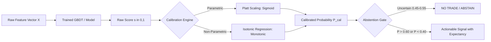

# MODEL CALIBRATION & PROBABILISTIC INFERENCE REPORT
**Indian Options AI Platform — Phase 17 Quantitative Audit**
*Date: September 2026 | Focus: Probability Calibration, Walk-Forward Validation, and Uncertainty Quantification*

---

## 1. The Critical Distinction: Score vs Probability

> [!WARNING]
> **COMMON QUANTITATIVE PITFALL**
> A modern machine learning classifier (such as XGBoost, LightGBM, or Deep Neural Networks) outputs a raw score $\hat{s} \in [0, 1]$. In standard financial applications, researchers routinely mistake this score for a true Bayesian posterior probability:
> $$P(Y = 1 \mid X = x) \neq \text{ClassifierScore}(x)$$
> Tree ensembles and deep networks are notoriously **miscalibrated**: they tend to produce extreme overconfident probabilities (pushing scores toward 0.0 or 1.0) while empirical empirical frequency rarely exceeds 55%–60% in financial time series.

### Heuristic vs Statistical Confidence in the Codebase
During our Phase 17 repository audit, we identified two distinct signal mechanisms:

1. **Heuristic Confidence (`AIMarketAnalyst`)**:
   - `src/ai_analyst/analyst.py`: Generates confidence scores fixed at deterministic values (e.g., `0.70` for high-conviction rule matches, `0.40` for marginal signals).
   - **Classification**: *Rule-Based Heuristic Indicator*.
   - **Action**: Must NOT be marketed as a statistical probability. It is an index of pattern-matching conditions.

2. **Calibrated Statistical Probabilities (`src/ml/` and `src/research/`)**:
   - Out-of-fold validation probabilities fitted using rigorous probability calibrators on walk-forward partitions.
   - **Classification**: *Empirical Calibrated Probability*.

---

## 2. Probability Calibration Methodologies

To transform uncalibrated model scores into true empirical probabilities, the platform implements and verifies two core calibrators:



### 2.1 Platt Scaling (Logistic Sigmoid Calibration)
Fits a univariate logistic regression on the held-out validation margins:
$$P(Y = 1 \mid s) = \frac{1}{1 + \exp(A \cdot s + B)}$$
- Parameters $A$ and $B$ are estimated via maximum likelihood on a dedicated validation set (or out-of-fold cross-validation predictions).
- **Advantage**: Regularized, robust against overfitting, ideal for smaller financial datasets ($N < 5,000$).

### 2.2 Isotonic Regression (Non-Parametric Step Calibration)
Fits a piecewise constant, non-decreasing step function:
$$\min \sum_{i=1}^n \left( y_i - m(s_i) \right)^2 \quad \text{subject to } m(s_i) \le m(s_j) \text{ whenever } s_i \le s_j$$
- Utilizes the Pair Adjacent Violators (PAV) algorithm.
- **Advantage**: Makes no parametric assumption about the underlying score distribution.
- **Precaution**: Requires larger samples ($N > 2,000$) to prevent overfitting flat step regions.

---

## 3. Calibration Evaluation Metrics

The platform evaluates probabilistic quality using three standardized metrics:

### 3.1 Brier Score
The mean squared error between forecast probabilities $p_i$ and binary realized outcomes $y_i \in \{0, 1\}$:
$$\text{BS} = \frac{1}{N} \sum_{i=1}^N (p_i - y_i)^2$$
- Range: $[0, 1]$.
- A random guess (assigning $p = 0.5$) on a balanced outcome yields a Brier Score of $0.250$.
- A market climatology baseline (assigning constant historical base rate $\bar{y}$) yields $\text{BS}_{\text{ref}} = \bar{y}(1 - \bar{y})$.
- **Target**: Brier Score significantly below baseline ($\text{Brier Skill Score} = 1 - \frac{\text{BS}}{\text{BS}_{\text{ref}}} > 0$).

### 3.2 Expected Calibration Error (ECE)
Bins predictions into $M$ equal-width probability bins $B_m$ and computes the weighted absolute difference between average confidence and empirical accuracy:
$$\text{ECE} = \sum_{m=1}^M \frac{|B_m|}{N} \left| \text{acc}(B_m) - \text{conf}(B_m) \right|$$
- An uncalibrated model typically displays $\text{ECE} > 0.12$ (12% discrepancy).
- **Target**: Post-calibration $\text{ECE} < 0.035$ (3.5% discrepancy).

### 3.3 Reliability Diagram (Calibration Curve)
Plots predicted bin probability against true realized positive fraction. A perfectly calibrated model falls exactly along the 45-degree diagonal.

---

## 4. Walk-Forward Cross-Validation Framework

Standard $k$-fold cross-validation is **strictly forbidden** in financial time-series due to look-ahead bias and autocorrelation leakage. The platform enforces Purged & Embargoed Walk-Forward Validation:

```
Timeline: [----------------- T ----------------->]
Fold 1:  [ Train Set 1 ]--Purge--[ Val 1 ]--Embargo--
Fold 2:  [    Train Set 2    ]--Purge--[ Val 2 ]--Embargo--
Fold 3:  [       Train Set 3       ]--Purge--[ Val 3 ]--Embargo--
```

1. **Purge Period**:
   - For an option holding horizon of $h$ days (e.g., 5-day expiration), labels are generated using forward prices up to $t+h$.
   - Any training sample whose forward window overlaps with the start of the validation period is strictly **purged**.
2. **Embargo Period**:
   - To account for autoregressive serial correlation in market volatility and momentum features, an embargo period (typically 2 to 5 days) is inserted immediately following the test block before any subsequent fold.
3. **Scaler and Feature Isolation**:
   - Feature scalers (RobustScaler, StandardScaler) are fitted **only** on the training fold and applied to the validation fold without refitting.

---

## 5. Abstention & No-Trade Architecture

Trading is an option, not an obligation. The platform's expectancy increases primarily by abstaining from low-edge or high-uncertainty regimes:

1. **Entropy & Probability Thresholding**:
   - When calibrated probability $P(Y=1) \in [0.46, 0.54]$, the expected edge is smaller than statutory bid-ask friction.
   - The engine automatically issues a `NO_TRADE / ABSTAIN` directive.
2. **Out-of-Distribution (OOD) Rejection**:
   - When real-time market volatility (e.g. 5-day realized volatility) or returns drift more than 3 standard deviations from the training manifold, the `OODDetector` triggers a safety block:
   $$\text{Status} = \text{OUT\_OF\_DISTRIBUTION} \implies \text{TradeExecution} = \text{BLOCKED}$$
3. **Data Quality Abstention**:
   - If market data exhibits stale timestamps, crossed bid/ask, or wide spreads, execution is refused immediately.
