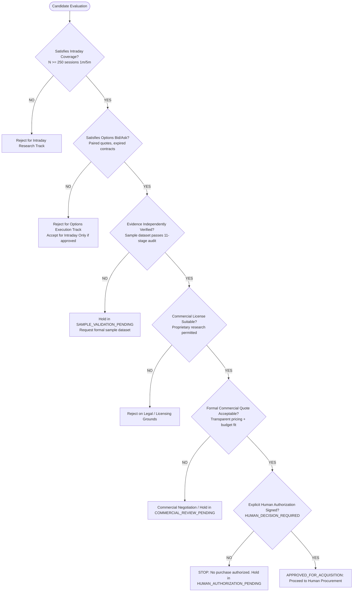

# Market Data Acquisition Decision Tree

## Strict Decision Rules
1. **Zero Automated Purchasing**: Under no circumstances may an automated process transition state to `APPROVED_FOR_ACQUISITION` or trigger payment.
2. **Zero Research Unlock**: Ingesting acquired data does NOT automatically activate live or paper alpha research.
3. **Hard Gate Non-Override**: Cost scores cannot override missing technical capabilities.
